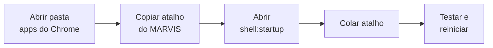

# Procedimento: Inicialização automática do MARVIS no Windows

2026-09-21 · Pedro Henrique Simas

## 1. Objetivo e escopo

Fazer o app MARVIS - Seu Ajudante Pessoal abrir sozinho sempre que o computador for ligado, sem nenhuma ação do usuário.

- **Aplica-se a:** computador com Windows 11.
- **Método adotado:** atalho do app na pasta de Inicialização do Windows.
- **Resultado validado:** o MARVIS abre automaticamente até 1 minuto após a área de trabalho aparecer.

## 2. Informações do ambiente

O MARVIS está instalado como **app do Chrome**, não como programa tradicional. Por isso a busca do menu Iniciar pode não encontrá-lo, e o Windows o exibe com outro nome.

| Item | Valor |
| --- | --- |
| Nome do atalho | MARVIS - Seu Ajudante Pessoal |
| Local do atalho original | `C:\Users\SEU_USUARIO\AppData\Roaming\Microsoft\Windows\Start Menu\Programs\apps do Chrome` |
| Pasta de Inicialização (comando) | `shell:startup` |
| Pasta de Inicialização (caminho) | `C:\Users\SEU_USUARIO\AppData\Roaming\Microsoft\Windows\Start Menu\Programs\Startup` |
| Nome no Gerenciador de Tarefas | chrome_proxy |

**Pré-requisito:** o Google Chrome deve estar instalado, pois é ele que executa o MARVIS.

## 3. Procedimento de configuração

1. **Abrir a pasta do atalho original.**
   - Pressione `Windows + R` para abrir a caixa Executar.
   - Apague o que estiver escrito e cole: `C:\Users\SEU_USUARIO\AppData\Roaming\Microsoft\Windows\Start Menu\Programs\apps do Chrome`
   - Pressione `Enter`. Abre a pasta com o item MARVIS - Seu Ajudante Pessoal (tipo: Atalho).
2. **Copiar o atalho do MARVIS.**
   - Clique uma vez sobre MARVIS - Seu Ajudante Pessoal, sem dar duplo clique.
   - Pressione `Ctrl + C`. Mantenha a janela aberta.
   - Atenção: copie o atalho, não a pasta "apps do Chrome".
3. **Abrir a pasta de Inicialização.**
   - Pressione `Windows + R`, digite `shell:startup` (sem espaços) e pressione `Enter`.
   - Abre a pasta chamada Inicializar, normalmente vazia.
4. **Colar o atalho.**
   - Clique em um espaço vazio da pasta Inicializar e pressione `Ctrl + V`.
   - Confira: deve aparecer somente MARVIS - Seu Ajudante Pessoal, tipo Atalho, e nenhuma pasta amarela.
5. **Evitar que pastas reabram sozinhas.**
   - No Explorador de Arquivos, clique em `...` → Opções → aba Modo de Exibição.
   - Desmarque "Restaurar janelas de pastas anteriores ao fazer logon" e clique em OK.

## 4. Verificação e teste

1. **Testar o atalho.** Na pasta Inicializar, dê dois cliques em MARVIS - Seu Ajudante Pessoal. O assistente deve abrir.
2. **Conferir no Gerenciador de Tarefas.**
   - Pressione `Ctrl + Shift + Esc` → menu lateral → Aplicativos de inicialização.
   - Localize **chrome_proxy** (é o MARVIS). O Status deve ser **Habilitado**.
   - "Impacto: Não medido(a)" é normal antes do primeiro reinício.
3. **Teste final.**
   - Feche todas as janelas e reinicie (Iniciar → Ligar/Desligar → Reiniciar).
   - Faça o login normalmente.
   - Aguarde até 1 minuto após a área de trabalho aparecer, sem abrir nada.

**Critério de aceitação:** o MARVIS abre sozinho numa janela do Chrome. Resultado obtido: aprovado.

## 5. Solução de problemas

| Sintoma | Causa | Ação |
| --- | --- | --- |
| MARVIS não aparece na busca do menu Iniciar | É um app do Chrome, fora da lista de programas comuns | Usar o caminho da pasta "apps do Chrome" (seção 2) |
| Ao ligar, abre a pasta "apps do Chrome" e o assistente não executa | Foi colocado na Inicialização um atalho da pasta, não do MARVIS | Excluir o item de pasta em `shell:startup` e colar o atalho correto (etapas 1 a 4) |
| Pasta reabre sozinha ao ligar | Windows restaurando janelas abertas antes do reinício | Desmarcar "Restaurar janelas de pastas anteriores ao fazer logon" (etapa 5) |
| MARVIS abre com dois cliques, mas não ao ligar | Chrome ainda não está pronto no momento da inicialização | Usar `chrome://apps` → botão direito no MARVIS → "Iniciar o app ao fazer login", ou Agendador de Tarefas com atraso de 30 s |
| MARVIS abre duas vezes | Dois métodos de inicialização ativos ao mesmo tempo | Manter apenas um método |

## 6. Como desativar

Use uma das opções abaixo. Nenhuma delas desinstala o MARVIS.

- **Pausar temporariamente:** `Ctrl + Shift + Esc` → Aplicativos de inicialização → clique em chrome_proxy → Desabilitar. Para voltar, clique em Habilitar.
- **Remover definitivamente:** `Windows + R` → `shell:startup` → exclua o atalho MARVIS - Seu Ajudante Pessoal.
